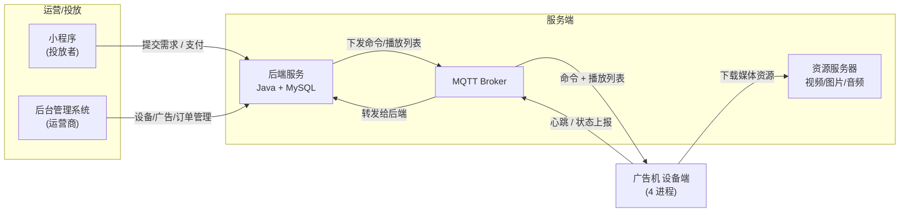
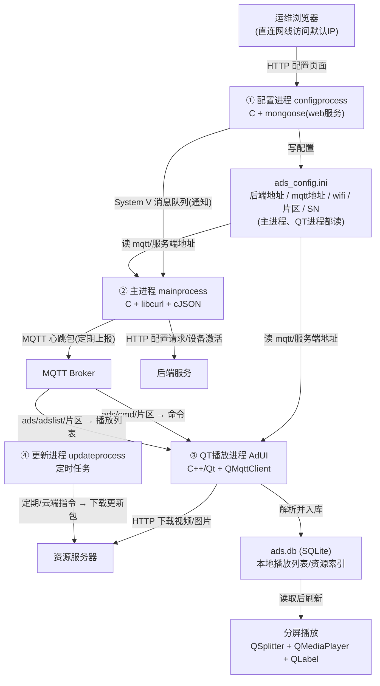

这是我做智能多媒体广告机项目时的架构复盘。项目围绕「运营商投放广告 → 广告机播放 → 数据回流」这条链路展开,设备端用 C/C++/Qt 拆成 4 个进程。这篇文章把整体架构和设备端的关键流程梳理一遍,既是记录,也是面试复盘时的一条主线。

## 一、整体系统架构

系统一共 6 类角色:

| 组件 | 技术 | 职责 |
| --- | --- | --- |
| 广告机(设备端) | C/C++/Qt,4 进程 | 播放广告、上报状态、接收并执行命令 |
| 后端服务 | Java + MySQL | 设备/播放列表/订单的增删改查,对外提供 HTTP 接口 |
| 后台管理系统 | Java 全栈 | 运营商用:设备管理、健康监控、指令/播放列表下发、广告投送管理 |
| 小程序(用户端) | Java 全栈 | 投放者用:提交投放需求、查看订单、支付 |
| MQTT Broker | — | 设备与后端之间的消息中转(心跳、命令、播放列表) |
| 资源服务器 | 阿里云/华为云 | 存放视频/图片/音频等媒体资源,设备从这里下载 |

**数据流(一条完整闭环):**



关键结论:**设备端对外只走两条通道**——一次性/请求-响应类走 **HTTP(libcurl)**,长连接/推送类(心跳、命令、播放列表)走 **MQTT**。

## 二、设备端四进程

设备端按「进程即模块」的思路拆成 4 个独立进程,互相解耦:



### 四个进程的职责

1. **配置进程**(`configprocess`,C):运维首次安装时直连网线,浏览器访问设备默认 IP 的配置页面(mongoose 起 HTTP 服务),填写后端地址、MQTT 地址、wifi、片区、位置、SN,保存到 `~/.config/ads_config.ini`,再发一条 **System V 消息队列**消息通知主进程。

2. **主进程**(`mainprocess`,C):收到配置进程的通知后,先从 `ads_config.ini` 读出 **mqtt 地址和服务端地址**,再用 **libcurl** 向后端发配置请求(设备激活/注册);持续用 **MQTT 心跳包**上报状态——后端据此判断设备是否在线,多次收不到就标记故障、通知维修。子线程订阅消息队列,主线程发心跳。

3. **QT 播放进程**(`AdUI`,C++/Qt):启动时先从 `ads_config.ini` 读出 mqtt 地址和服务端地址,连接 MQTT 后订阅两个主题:`ads/cmd/{片区}`(命令:重启/更新)和 `ads/adslist/{片区}`(播放列表)。收到播放列表后,通过 HTTP 从资源服务器下载媒体到本地、解析入库 SQLite,再通知界面刷新播放;用 QSplitter 做分屏、QMediaPlayer+QMediaPlaylist 播视频、QLabel 播图片。

   > 设计决策:播放列表的「拉取+解析+下载」放在 QT 进程做,而不是主进程——因为纯 C 写 MQTT 解析和下载难维护。

4. **更新进程**(`updateprocess`):两种触发——定时任务周期性检查版本;立即更新由云端下发更新指令、设备收到后执行。负责下载并替换设备端程序。

### 进程间通信方式

- 配置进程 → 主进程:**System V IPC 消息队列**(进程内解耦)
- 设备 ↔ 后端:**MQTT**(心跳、命令、播放列表)+ **HTTP**(配置请求)
- 进程间共享数据:`ads_config.ini`(配置进程写,主进程和 QT 进程都读)和 `ads.db` SQLite(播放列表)

## 三、QT 播放进程的关键流程

QT 播放进程(AdUI)是设备端的核心,负责连 MQTT、下载素材、入库、分屏播放。下面拆三个流程。

### 3.1 启动流程

1. `MqttLogic::getInstance()`:读 `ads_config.ini` 拿到 `mqttUrl`、`area`,解析出 host/port,创建 `QMqttClient`,设 host/port/账号/clientId,然后 `connectToHost()`——只是**发起异步连接**,不阻塞、不等待。

2. `AdsLogic::getInstance()`:打开 SQLite(`AdDao` + `AdResourceDao`,连接名 `ads_player`)。

3. `AdUi` 构造:`buildUi()` 建上/中/下三屏;再建一个 `AdResourceDao`(复用同一个数据库连接);建 `QMediaPlayer`;`WeatherLogic::getInstance()` 懒加载,此时才第一次创建并立刻拉天气。

4. `ui.startPlay()`:`loadVideos()` / `loadImages()` 从数据库读本地路径 → 播第一条。

5. `exec()` 进入事件循环:MQTT 连接成功后才订阅 `ads/cmd/{area}`、`ads/adsList/{area}`;天气返回更新底栏;时钟每秒 tick 刷时间。

### 3.2 播放列表的拉取与下载

MQTT 订阅成功后,服务端 publish 播放列表 JSON 到 `ads/adsList/{area}`,触发下面的处理链:

1. **收到**:`MqttLogic` 收到消息 → 调 `AdsLogic::parseDownloadAndSaveToSqlite(json)`。

2. **解析**:`AdsParser::parse` 把 JSON 转成 `QList<Ad>`,信息含广告 id、素材远程 url、sha256 签名 sign、type(1=视频/2=图片)。

3. **逐个广告下载**:对每个广告,`adDao->loadById(id)` 查库判断新广告还是旧广告(新的写 `t_ad`,旧的 update);再逐个素材 `downloadResource()`:
   - `FileDownloader.download(url)` 走 HTTP 从服务端拉文件;
   - `waitForFinished` 阻塞等下载完;
   - `HashUtils::fileSha256` 校验 == sign;
   - `adResourceDao->save/update` 写 `local_path` 到 `t_ad_resource`。

4. **通知**:有变化才 `emit notifyAdsUpdate()`。

5. **刷新播放**:`AdUi::adsUpdate()` → `startPlay()`,`loadVideos()` / `loadImages()` 读数据库里的本地路径 → `playVideo(0)` 播放。

### 3.3 命令处理:重启与更新

广告机收到 MQTT 指令后,在 `CmdExecutor` 里临时创建子进程去干活,有两种「创建」要分清:

```text
收到 {"cmd":1} 重启
   └─ CmdExecutor case 1
       └─ CmdUtil::execCmd → QProcess 临时起「子进程」执行 reboot 命令 → 等它结束

收到 {"cmd":2} 更新
   └─ CmdExecutor case 2 → doUpdate
       ├─ FileDownloader 下载(异步网络,不新开进程)
       ├─ QProcess 临时起「子进程」执行 tar 解压 → 等它结束
       └─ QProcess::startDetached → 启动新版本 exe(「分离进程」,独立运行)
```

## 总结

这个项目最核心的架构思想是两条:

1. **进程即模块**:设备端拆成配置/主/播放/更新 4 个进程,进程间用消息队列和共享文件(ini + sqlite)解耦。好处是故障隔离——播放进程崩了,主进程的心跳照常上报,后端仍知道设备活着,还能单独拉起。

2. **双通道分工**:HTTP 管一次性请求,MQTT 管长连接推送。命令和播放列表要后端主动推、要实时,放 MQTT;配置请求、素材下载这些请求-响应类,放 HTTP。各干各擅长的,链路才清晰。
